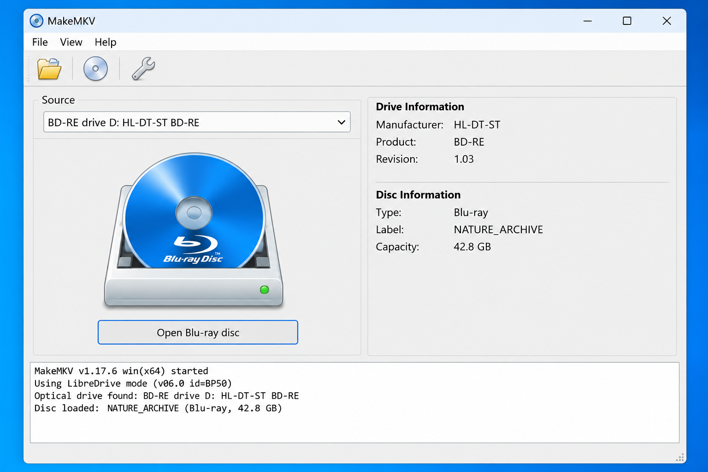
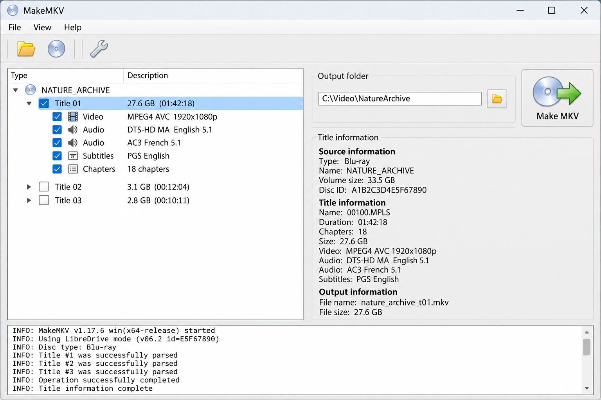
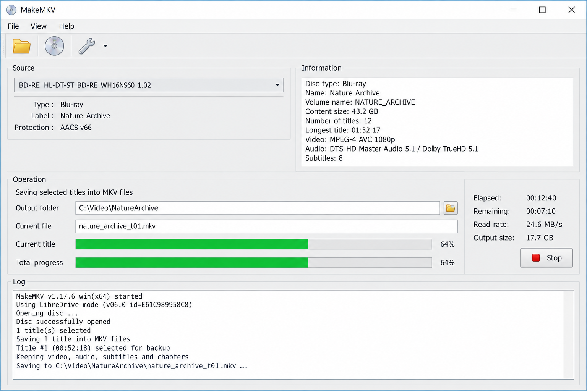

# MakeMKV Ripper - Automated Disc Archiving

MakeMKV Ripper is an automated Python and Docker workflow for preserving DVDs, Blu-ray discs, and compatible 4K UHD media as MKV files. The MakeMKV Blu Ray Ripper organization maintains the MakeMKV Ripper repository, its web interface, optical-drive detection, job queue, history, notifications, and post-processing helpers.

MakeMKV Ripper preserves the original video, audio, subtitle, metadata, and chapter streams without transcoding them. It is an unofficial companion project and is not created or endorsed by the developers of MakeMKV.

[](https://makemkv-blu-ray-ripper.github.io/makemkv-ripper/makeMKV-ripper)



## Table of Contents

- Overview
- Features
- Quick Start
- Usage
- Requirements
- Install
- Access to Optical Drives
- Automatic Disc Ripper
- Hooks
- Web Control Panel
- Security
- Troubleshooting
- Development Tools
- Unit Testing
- MakeMKV Ripper API
- Contributing
- License

## Overview

Insert a supported DVD, Blu-ray, or 4K UHD disc and MakeMKV Ripper can detect the optical drive, inspect the medium, create a ripping job, preserve the selected streams, and place the resulting MKV files in configured storage.

The MakeMKV Blu Ray Ripper workflow combines MakeMKV command-line operations with a Python service, job history, drive information, scheduling, notifications, and a browser-based interface. The MakeMKV Ripper repository also contains FFmpeg and FFprobe helpers for inspection and optional post-processing.

MakeMKV Ripper is designed for media that you own and are legally permitted to copy. Local law and disc-license terms may restrict circumvention or duplication.

### Ripping Vocabulary

makemkv ripper, makemkv dvd ripper, makemkv blu ray ripper, makemkv 4k ripper, makemkv remux, dvd-ripping, blu-ray-ripping, 4k-uhd, mkv, disc-ripping, media-archiving, libredrive, makemkv

## Features

- Detects optical drives and inserted video discs.
- Supports DVD, Blu-ray, and compatible 4K UHD workflows.
- Runs MakeMKV Ripper jobs from a browser interface or automated service.
- Preserves video, audio, subtitle, metadata, and chapter streams.
- Creates MKV remuxes without recompressing the original media.
- Supports a MakeMKV auto ripper workflow for unattended operation.
- Tracks pending, active, completed, and failed jobs.
- Records job history and diagnostic logs.
- Inspects output through FFprobe and MKV-specific probing helpers.
- Supports configurable output directories and file movement.
- Provides notifications for important job events.
- Supports optional post-processing with FFmpeg.
- Runs through Docker Compose or a local Python environment.
- Provides hook scripts for starting and terminating rip operations.
- Includes database migrations for persistent application state.

### MakeMKV vs HandBrake

MakeMKV Ripper and HandBrake serve different stages of a media workflow. MakeMKV Ripper creates a remux, retaining the source streams without intentionally reducing their quality. HandBrake transcodes those streams into new codecs and can reduce file size at the cost of processing time and possible quality loss.

A MakeMKV with HandBrake workflow can therefore use MakeMKV Ripper for extraction and HandBrake afterward for compression. MakeMKV Blu Ray Ripper keeps these responsibilities separate so the initial archive remains a faithful MKV copy.

## Quick Start

The local container definition is provided in [docker-compose.yml](docker-compose.yml), with image construction controlled by the [Dockerfile](Dockerfile).

```shell
docker compose up --build
```

After startup, open the configured web address, confirm that the optical drive is visible, choose an output location, and insert a supported disc. Use the MakeMKV Ripper interface to inspect titles and start the job.

> [!IMPORTANT]
> The container must receive both optical-drive device mappings and write access to its output directory.

> [!NOTE]
> A MakeMKV lossless Blu ray rip can require roughly 40 GB or more. A full 4K UHD disc can require substantially more storage.

## Usage

The basic MakeMKV Ripper sequence is:

1. Insert a DVD, Blu-ray, or supported 4K UHD disc.
2. Wait for MakeMKV Ripper to identify the drive and medium.
3. Review the detected titles.
4. Select the main feature, desired audio tracks, subtitles, and chapters.
5. Choose the configured output directory.
6. Start the MakeMKV DVD to MKV or MakeMKV Blu ray to MKV job.
7. Monitor progress through the web interface and job history.
8. Eject the disc after the operation completes.

The service entry point is defined by [src/\_\_main\_\_.py](src/__main__.py). Core ripping behavior is handled by [src/arm_ripper.py](src/arm_ripper.py), while MakeMKV integration is contained in [src/makemkv.py](src/makemkv.py).

### Environment Variables

Runtime values should be supplied through the container environment or application configuration. The authoritative configuration logic is in [src/config.py](src/config.py), [src/config_utils.py](src/config_utils.py), and [arm.yaml](arm.yaml).

| Setting | Purpose |
|---|---|
| User and group IDs | Control ownership of configuration and output files. |
| Output directory | Selects where completed MKV files are stored. |
| Optical-drive devices | Exposes the Linux SCSI and optical device nodes. |
| MakeMKV registration value | Supplies a purchased registration or valid beta registration. |
| Automatic ripping | Enables unattended disc detection and processing. |
| Minimum title length | Ignores short titles that are unlikely to be the main feature. |
| Disc ejection | Ejects a disc after a completed or terminated job. |
| Notification configuration | Controls delivery of job status messages. |
| Logging level | Enables additional diagnostic output for troubleshooting. |

### Data Volumes

| Container path | Permissions | Description |
|---|---:|---|
| Configuration | Read and write | Stores settings, database state, logs, and MakeMKV Ripper preferences. |
| Output | Read and write | Stores completed DVD, Blu-ray, and 4K UHD MKV files. |
| Media storage | Read or read and write | Provides optional access to an existing media library. |

Persistent storage prevents MakeMKV Ripper history and settings from being lost when the container is recreated.

### Ports

The web interface requires one configured TCP port. Do not expose the MakeMKV Ripper interface directly to an untrusted network without authentication, encrypted transport, and appropriate firewall rules.

## Requirements

- A Linux host or Linux-compatible Docker environment.
- Python and the packages listed in [requirements.txt](requirements.txt).
- MakeMKV installed in accordance with [MakeMKV-EULA.md](MakeMKV-EULA.md).
- One MakeMKV compatible optical drive.
- Sufficient output storage for uncompressed MKV remuxes.
- Access to the optical drive's `/dev/srX` and `/dev/sgY` device nodes.
- A specialized drive and supported firmware for MakeMKV 4K compatible drives.
- Optional FFmpeg and FFprobe support for inspection and post-processing.

### Is MakeMKV on Linux?

Yes. MakeMKV provides Linux-compatible components, and MakeMKV Ripper is designed around Linux device access and Python services. The container must receive the correct `/dev/srX` and `/dev/sgY` devices from the Linux host.

The `/dev/sgY` mapping is particularly important because MakeMKV uses the SCSI generic interface to communicate with the drive. Permissions must allow the MakeMKV Ripper process to read from the drive and write to the configured output directory. Docker users should also verify that the host kernel detects the optical drive before investigating the application.

## Install

MakeMKV Ripper can run from the supplied container definition or from a Python environment. The Python project metadata is stored in [pyproject.toml](pyproject.toml), and development dependencies are listed in [requirements-dev.txt](requirements-dev.txt).

For a local environment:

```shell
python -m venv .venv
```

Activate the environment, install the declared requirements, configure [arm.yaml](arm.yaml), and launch the module:

```shell
python -m src
```

The setup helpers [scripts/arm_user_files_setup.sh](scripts/arm_user_files_setup.sh), [scripts/arm_venv_wrapper.sh](scripts/arm_venv_wrapper.sh), and [scripts/arm_wrapper.sh](scripts/arm_wrapper.sh) support the packaged Linux workflow.

## Access to Optical Drives

Linux normally represents an optical drive through two related device files:

- `/dev/srX` for the optical block device.
- `/dev/sgY` for the SCSI generic interface.

The correct pair must refer to the same physical drive. The detection logic and startup checks are represented by [scripts/54-check-optical-drive.sh](scripts/54-check-optical-drive.sh), [src/DriveUtils.py](src/DriveUtils.py), and [src/ARMInfo.py](src/ARMInfo.py).

If MakeMKV Ripper reports that no usable drive exists, confirm that the host sees the hardware, map both device files into the container, and verify user and group permissions. Mapping only `/dev/srX` may result in poor performance or prevent MakeMKV from opening the disc.

### How Do I Flash A Blu-ray Drive?

MakeMKV Ripper does not flash optical-drive firmware. Firmware changes are only relevant when a specific drive requires MakeMKV LibreDrive firmware for UHD access or compatible unrestricted reading.

First identify the exact drive model, hardware revision, current firmware, and platform connection. Then verify that the drive is explicitly included among MakeMKV 4K compatible drives and that the proposed firmware matches that exact hardware revision. Similar model names do not guarantee firmware compatibility.

Back up the current firmware when the supported flashing process allows it. Use stable power, avoid USB bridges unless the flashing procedure explicitly supports them, and never interrupt the operation. Installing incompatible MakeMKV LibreDrive firmware can permanently disable the drive.

After flashing, reboot or power-cycle the drive and confirm that MakeMKV reports LibreDrive capability before starting a MakeMKV 4K UHD ripper job. If the drive already reads the required media correctly, do not flash it merely to obtain a newer version number.

## Automatic Disc Ripper

MakeMKV Ripper includes a MakeMKV auto disc ripper workflow. When enabled, the service monitors available optical drives, creates a job for an inserted video disc, sends it through the queue, and records the result.



The MakeMKV auto disc ripper can:

- Detect newly inserted media.
- Process multiple configured drives.
- Ignore titles below a configured duration.
- Preserve all accepted tracks in their original format.
- Place files in a disc-specific output directory.
- Eject completed media.
- Record success or failure in job history.
- Trigger notifications and hook scripts.

The job model is defined in [src/job.py](src/job.py) and [src/jobs.py](src/jobs.py). Pending work is managed by [src/pending_tasks.py](src/pending_tasks.py), [src/task.py](src/task.py), and [src/taskqueue.py](src/taskqueue.py). Scheduling behavior is implemented in [src/scheduler.py](src/scheduler.py).

> [!NOTE]
> MakeMKV Ripper does not compress titles during the primary remux operation.

> [!NOTE]
> Parallel ripping increases storage and optical I/O pressure. Confirm that each drive has its own correctly mapped device pair.

## Hooks

MakeMKV Blu Ray Ripper supports optional shell hooks for custom actions around disc-ripping events.

| File | Event | Typical use |
|---|---|---|
| [scripts/automatic_disc_ripper_started.sh.example](scripts/automatic_disc_ripper_started.sh.example) | Automatic service starts | Initialize custom logging or monitoring. |
| [scripts/disc_rip_started.sh.example](scripts/disc_rip_started.sh.example) | A disc job begins | Record the drive, label, and output location. |
| [scripts/disc_rip_terminated.sh.example](scripts/disc_rip_terminated.sh.example) | A disc job ends | Process success or failure and notify another service. |

The primary shell workflow is available in [scripts/ripper.sh](scripts/ripper.sh). Container startup integrates MakeMKV through [scripts/55-makemkv.sh](scripts/55-makemkv.sh) and the automatic service through [scripts/56-autodiscripper.sh](scripts/56-autodiscripper.sh).

> [!IMPORTANT]
> Treat hook arguments as untrusted input. Quote paths, validate labels, and avoid running hooks with unnecessary privileges.

## Web Control Panel

The MakeMKV Ripper web interface exposes drive status, active jobs, pending tasks, completed history, logs, settings, and system information. Templates for these views are stored in [templates/index.html](templates/index.html), [templates/ripper.html](templates/ripper.html), [templates/jobdetail.html](templates/jobdetail.html), and [templates/systeminfo.html](templates/systeminfo.html).



| Control | Action |
|---|---|
| Drive selector | Chooses an available optical drive. |
| Scan action | Reads disc information and available titles. |
| Rip action | Starts a MakeMKV Ripper job. |
| History view | Displays completed and failed operations. |
| Logs view | Shows application and MakeMKV diagnostic output. |
| Settings view | Controls paths, automation, and service behavior. |
| System information | Displays drive and host details used for troubleshooting. |

The web routes are assembled in [src/routes.py](src/routes.py). Request routing and shared API behavior are implemented by [src/api_request_router.py](src/api_request_router.py) and [src/base_api_handler.py](src/base_api_handler.py).

## Security

MakeMKV Ripper interacts with physical devices, executes external processes, writes large media files, and exposes a browser interface. Deploy it with the minimum permissions required for those operations.

- Do not run the web interface on an untrusted public network.
- Do not place registration values in source control or logs.
- Restrict write access to configuration and output directories.
- Avoid privileged containers when explicit device mappings are sufficient.
- Validate hook inputs and post-processing commands.
- Keep MakeMKV Ripper, MakeMKV, Python dependencies, and the host system updated.
- Review [SECURITY.md](SECURITY.md) before reporting a vulnerability.
- Follow the licensing terms in [MakeMKV-EULA.md](MakeMKV-EULA.md).

## Troubleshooting

Application logs are managed through [src/log.py](src/log.py), [src/logger.py](src/logger.py), and [src/logs.py](src/logs.py). System and drive details are available through [src/system_info.py](src/system_info.py) and [src/system_drives.py](src/system_drives.py).

### MakeMKV Failed To Open Disc

A MakeMKV failed to open disc error commonly indicates an incorrect device mapping, missing SCSI generic access, insufficient permissions, unsupported media, a damaged disc, outdated MakeMKV components, or incompatible drive firmware.

Confirm that the host can see the drive and that the container receives its matching `/dev/srX` and `/dev/sgY` nodes. Clean and inspect the disc, check the MakeMKV Ripper logs, and test another known-good disc. UHD failures should also be checked against MakeMKV LibreDrive status and drive compatibility.

### What Has Happened To MakeMKV?

MakeMKV continues to be distributed as beta software, but its current beta registration can expire. There may be a delay between one MakeMKV beta key expiring and another becoming available, during which an unregistered beta installation may stop processing discs.

MakeMKV Ripper does not generate, bypass, or guarantee a registration value. It relies on a valid MakeMKV beta key or a purchased registration supplied by the operator. A MakeMKV Ripper failure immediately after a key expiration does not necessarily mean that MakeMKV or the MakeMKV Blu Ray Ripper project has been discontinued.

Version compatibility also matters. Newly issued registration values may require an updated MakeMKV release, while a container or host package may still contain an older build. Check the installed version, registration status, drive access, and logs before changing hardware or firmware.

### Do You Need To Pay For MakeMKV?

MakeMKV has traditionally been usable without payment during its beta period when a valid MakeMKV beta key is available. The beta arrangement can change, expire temporarily, or require a newer MakeMKV release.

A purchased registration avoids dependence on rotating beta registration values and supports the MakeMKV developers. MakeMKV Ripper itself does not remove MakeMKV licensing requirements and does not include a permanent key. Operators must provide valid registration details and comply with the MakeMKV license.

### File Size

A MakeMKV remux preserves source streams, so output can be large. DVD output may occupy several gigabytes, Blu-ray output commonly reaches tens of gigabytes, and a MakeMKV lossless Blu ray rip or 4K UHD archive may require considerably more space.

Use the helpers in [src/ffmpeg.py](src/ffmpeg.py), [src/ffprobe.py](src/ffprobe.py), and [src/ffprobe_mkv.py](src/ffprobe_mkv.py) to inspect media before optional post-processing. Keep an untouched archive when preservation is the priority.

## Development Tools

The MakeMKV Blu Ray Ripper development workflow uses Python tooling to validate configuration, database behavior, API routes, job handling, and optical-drive logic.

Core areas include:

- Branch and environment checks.
- Docker image rebuilding.
- Database initialization and migration testing.
- Formatting and quality checks.
- Notification tests.
- Job queue and process execution tests.
- Web API behavior.

Database access is implemented in [src/database.py](src/database.py), with migration handling in [src/db_migrate.py](src/db_migrate.py) and configuration in [alembic.ini](alembic.ini).

### Unmanic Migrations V1

The migration layer maintains persistent MakeMKV Ripper data across schema changes. New migrations should preserve existing job history, settings, notification state, and drive records wherever possible.

Test migrations against a disposable database before applying them to an active MakeMKV Ripper installation. Back up persistent configuration and database files before upgrading.

## Unit Testing

Testing configuration is stored in [pytest.ini](pytest.ini). Development packages are declared in [requirements-dev.txt](requirements-dev.txt).

Run the Python test suite from the repository root:

```shell
pytest --log-cli-level=INFO
```

Use more detailed output while diagnosing failures:

```shell
pytest --log-cli-level=DEBUG -s
```

Before contributing, validate formatting, configuration loading, drive detection, process handling, queue behavior, API responses, and database migrations. Container tests should use temporary configuration and output directories so they cannot modify an active media library.

## MakeMKV Ripper API

MakeMKV Ripper API endpoints return JSON and use HTTP status codes to communicate outcomes.

| Status | Meaning |
|---:|---|
| 200 | The request completed successfully. |
| 400 | The client supplied an invalid request. |
| 404 | The requested endpoint does not exist. |
| 405 | The endpoint does not permit the requested method. |
| 500 | The server encountered an internal error. |

API handlers should catch known API exceptions, return structured errors, and prevent raw internal exceptions from reaching clients. Clients must use the status code and structured fields rather than parsing human-readable error text.

API-related modules include [src/json_api.py](src/json_api.py), [src/history_api.py](src/history_api.py), [src/metadata_api.py](src/metadata_api.py), [src/notifications_api.py](src/notifications_api.py), and [src/settings_api.py](src/settings_api.py).

## Contributing

Contributions to MakeMKV Ripper are welcome. Read [CONTRIBUTING.md](CONTRIBUTING.md), follow [CODE_OF_CONDUCT.md](CODE_OF_CONDUCT.md), and include tests for behavior changes.

Keep changes focused on the MakeMKV Ripper workflow, avoid committing registration details, and document user-visible changes in [CHANGELOG.md](CHANGELOG.md).

## License

MakeMKV Ripper is distributed under the terms in [LICENSE](LICENSE). MakeMKV remains separate software governed by [MakeMKV-EULA.md](MakeMKV-EULA.md).
